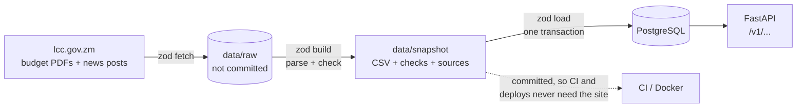

# Zambia Open Data

**Where does Lusaka's money come from, and where does it go?**

Lusaka City Council publishes its approved budgets as PDF books and its Constituency
Development Fund (CDF) projects as news posts. Both are public, but neither is easy to
search, compare or reuse. This project turns them into clean, checked open data and serves
it through a public API.

* **Budgets.** Every revenue line (rates, fees, levies, permits, grants, the CDF) and every
  spending line, by type and by programme, for the 2024 and 2025 books. Includes
  year-on-year changes.
* **CDF projects.** 54 council news stories about CDF projects, tagged by constituency,
  sector and stage (planned, under construction, handed over …). Each one links to the
  original post.
* **Checked numbers.** Every total printed in the books is re-added from its lines. The
  results are published with the data, along with SHA-256 fingerprints of the source files.

## What the data shows

From the council's own books:

* The budget grew **47.5%**, from **K732.1 million** in 2024 to **K1.08 billion** in 2025.
* Two lines drive most of that growth. A new **Social Protection and Community
  Development** programme (K266.8 million, the "Cash for Work" initiative) is now the
  biggest single programme, at 24.7% of spending. **Constituency Development** rose 17.7%,
  to K252.4 million.
* A third of 2025 revenue (32.9%) is **national grants**. Rates bring in 14.7%.
* The 2025 book **restates** three of 2024's approved figures. For example, Goods and
  Services goes from K224,550,733 to K225,202,017. The quality report flags this.
* Several of the books' printed totals are off by **K1–2** from their own lines. That is
  rounding inside the books, and it is reported as a warning, not hidden.

## How it works



1. **`zod fetch`** downloads the two budget books and every news post through the
   site's WordPress API. The site's TLS certificate is expired, so certificate checks are
   off for this one host; each file's SHA-256 goes into a manifest.
2. **`zod build`** parses the PDFs line by line and runs the quality checks. If any check
   fails, the snapshot is not written. It then writes `data/snapshot/`, the published
   dataset, which is plain CSV that opens in Excel.
3. **`zod load`** replaces the database contents in **one transaction**. Readers see the
   old dataset or the new one, never a mix. Loading the same snapshot twice gives
   identical data.

## Quality checks

`GET /v1/quality` and [`data/snapshot/checks.csv`](data/snapshot/checks.csv) list every
check:

| Check | Fails when |
|---|---|
| Revenue lines add up to each sub-total, and sub-totals to the grand total | The difference is bigger than rounding (half a kwacha per line) |
| Spending lines add up to the head total, for both tables | Same |
| Revenue equals spending (a council budget must balance) | They differ at all |
| Last year's figures, as reprinted this year, match last year's book | Never fails; a difference is a **warning** that lists each restated line |
| Duplicate news posts | Never fails; the newest copy is kept and the dropped ids are listed |

Today: **6 pass, 7 warn, 0 fail.**

## API

Run it locally (below), then open <http://localhost:8000/docs> for the interactive
OpenAPI docs.

| Endpoint | What it returns |
|---|---|
| `GET /v1/budgets` | Each budget year, its total and the change from the year before |
| `GET /v1/budgets/{year}` | Revenue by group and spending by type and programme, as shares of the total |
| `GET /v1/budgets/{year}/revenue?group_code=02&projections=true` | Every revenue line, optionally with the book's forward estimates |
| `GET /v1/budgets/{year}/changes?basis=programme` | Each spending line against last year, biggest movers first |
| `GET /v1/cdf/stories?constituency=Matero&sector=health&q=clinic` | CDF stories, filtered and paged, newest first |
| `GET /v1/cdf/constituencies` | Story counts and sectors for each of Lusaka's seven constituencies |
| `GET /v1/quality` | Every check, the source fingerprints and when the data was loaded |

```console
$ curl -s localhost:8000/v1/budgets
[{"year":2024,"total_zmw":732090165,"change_pct":null,...},
 {"year":2025,"total_zmw":1079607654,"change_pct":47.5,...}]
```

Amounts are whole Zambian kwacha (ZMW). The API is read-only and needs no key.

## Run it

With Docker:

```bash
docker compose up --build        # PostgreSQL + API on http://localhost:8000
```

Without Docker (Python 3.12 and a PostgreSQL you already have):

```bash
python -m venv .venv && . .venv/bin/activate      # Windows: .venv\Scripts\activate
pip install -e ".[dev]"
cp .env.example .env                              # then point DATABASE_URL at your database
alembic upgrade head
zod load                                          # loads the committed snapshot
uvicorn zod.api.main:app --reload --port 8000
```

To rebuild the dataset from the council's website: `zod fetch && zod build`.

## Tests

```bash
pytest       # 29 tests; API tests need TEST_DATABASE_URL (a database whose name ends in _test)
```

* **Parsers** run on text copied from the real books, including their quirks: a revenue line
  with no description, a total printed on the line *before* "Head Total", and an
  apostrophe the PDF font turns into `�`.
* **Checks** cover the rules above: rounding warns, a real gap or a missed line fails, and
  restated figures are flagged.
* **Migrations** run up, down and up again on an empty database.
* **API** tests run on PostgreSQL loaded with the real snapshot. They cover filters,
  paging, bad input and the 404 message. One test shows that a failed load leaves the old
  data in place.

CI runs lint (ruff), strict type checking (mypy), the tests on PostgreSQL 16 and a Docker
build on every push.

## Engineering decisions

| Decision | Why |
|---|---|
| Parse the PDF **text**, not its tables | pdfplumber's table detection collapses these books' columns. The text layer is clean and line-shaped. |
| **Re-add every total** and fail the build on a real mismatch | A parser that misses a line produces numbers that look right. Checking against the book's own totals turns that into a visible failure. |
| Treat a gap of **≤ half a kwacha per line** as rounding | The books print whole kwacha but total the unrounded figures. Calling that an error would be noise; hiding it would be dishonest. |
| Commit the **snapshot**, not the PDFs | The cleaned CSVs are small and diffable, and they are the actual dataset. CI and deploys never depend on the council site, which has an expired certificate. |
| Year-on-year changes use **this year's book only** | Programme codes and names change between books (Veterinary services, code 14, becomes Fisheries and Livestock, code 17). Each book reprints last year in its own codes, so comparing within one book is like for like. |
| Tag each money column with a **stage** (`budget`, `prior`, `projection`) | Each book prints three years. Without the stage, a 2026 projection from the 2024 book could be mistaken for an approved budget. |
| Load in **one transaction** | Readers never see a half-loaded dataset. A failed load changes nothing (this is tested). |
| News status reads the **headline first** | Bodies often recall earlier stages ("once under construction, now handed over"). The headline says what the story is about. |

## Limits

* Only the **2024 and 2025** budget books are on the council's site with a text layer.
  The 2018–2023 financial statements are scanned images and would need OCR.
* CDF story fields come from the wording of each post. `status` and the sector tags are
  best-effort; `largest_amount_zmw` is the largest amount the story *mentions*, which may
  not be the project's cost. Every story links to its source, so check it there.

## Roadmap

* **Milestone 2:** a Next.js explorer with charts of revenue and spending, year-on-year
  changes, and a CDF map by constituency.
* **Milestone 3:** a public deployment with a live demo, a scheduled monthly refresh, and
  CSV downloads from the API.

## Credits and licence

The first version of this dataset was built for the UNZA CSC 4792 (Data Mining and
Warehousing) mini-project by **Project Team #1**. This repository is a fresh rewrite by
[Kasonde Bbuku](https://github.com/kasondebbuku-spec), with new parsers, quality checks, a
database and an API.

The code is MIT licensed. The data is public information published by
[Lusaka City Council](https://www.lcc.gov.zm); this project is independent and not
affiliated with the council.
